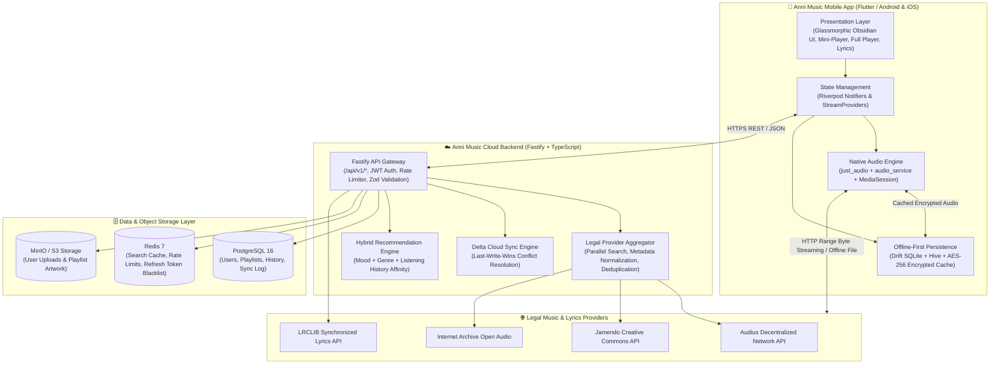
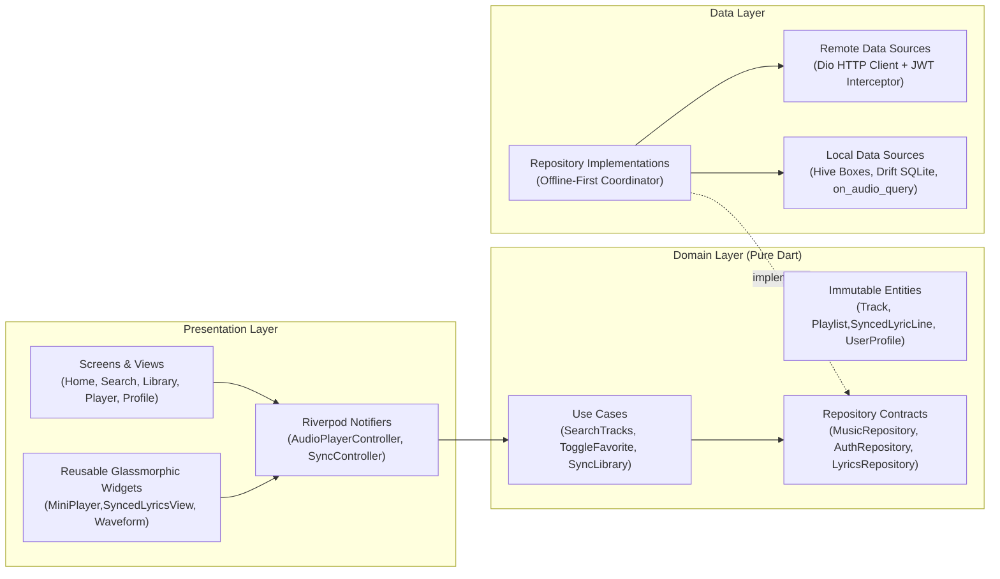
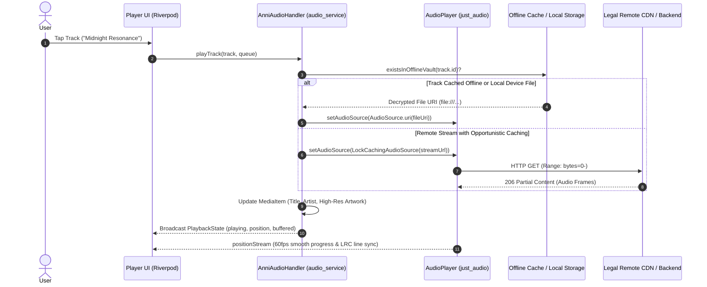
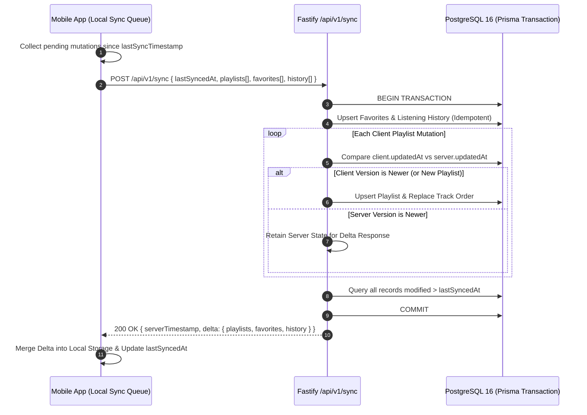
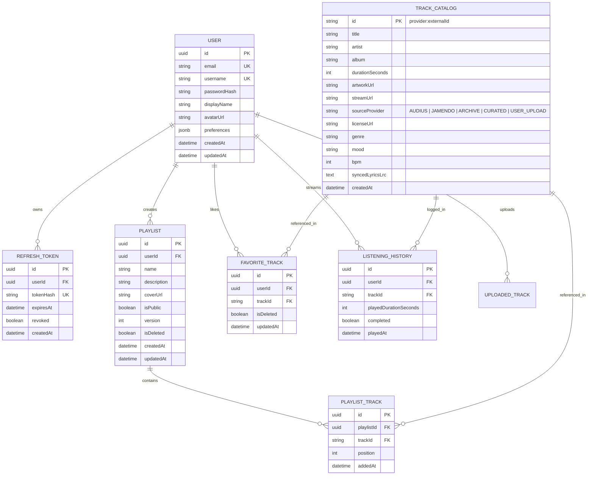

# Anni Music — System Architecture & Technical Design

> **Tagline**: *"Your music. Your world."*
> **Stack**: Flutter 3.x (Clean Architecture + Riverpod + `just_audio` + `audio_service` + Drift/Hive) • Node.js 20 + Fastify + TypeScript + Prisma + PostgreSQL 16 + Redis 7 + MinIO S3

---

## 1. High-Level System Context

Anni Music is an offline-first, cloud-synchronized mobile music platform engineered to stream licensed independent and Creative Commons tracks (via Audius, Jamendo, Internet Archive, and Curated CC catalogs), play device-local audio files (`mp3`, `flac`, `wav`, `m4a`, `ogg`), render time-synced LRC lyrics, and synchronize user libraries across devices.

---

## 2. Mobile Application Architecture (Flutter Clean Architecture)

The `/app` directory enforces strict **Feature-First Clean Architecture** separated into three concentric layers (`domain`, `data`, `presentation`) plus shared `core` services.

### Layer Responsibilities

| Layer | Directory | Responsibilities |
| :--- | :--- | :--- |
| **Core** | `app/lib/core/` | Theme (`#0A0A0F` obsidian dark palette, `#7C4DFF` electric violet, `#00E5FF` cyan accents), Dio HTTP client with automatic JWT token refresh, audio handler initialization, dependency injection. |
| **Domain** | `app/lib/features/*/domain/` | Pure Dart entities (`Track`, `Playlist`, `LyricLine`, `User`) and abstract repository interfaces with zero framework dependencies. |
| **Data** | `app/lib/features/*/data/` | DTO serialization, REST API calls, local Hive/SQLite caching, offline download manager, and `on_audio_query` local storage scanner. |
| **Presentation** | `app/lib/features/*/presentation/` | Riverpod `StateNotifier` / `AsyncNotifier` controllers, custom glassmorphic shaders, animated mini-player bar, full-screen synchronized lyrics sheet, and equalizer UI. |

---

## 3. Native Audio Engine & Background Foreground Service Flow

Anni Music delivers gapless playback, lock-screen media controls, Android Auto / Bluetooth AVRCP metadata, audio focus ducking, and headset unplug auto-pause via `just_audio` bridged with `audio_service`.

### Audio Features Engineered
- **Gapless Concatenating Queue**: Uses `ConcatenatingAudioSource` so the next track in the queue pre-buffers before the active track finishes.
- **Crossfade & Playback Speed**: Configurable `0s–12s` volume envelope crossfading and `0.5x–2.0x` pitch-preserved tempo control.
- **Sleep Timer**: Countdown timer with gentle 5-second logarithmic volume fade-out before pausing.
- **Android Foreground Service**: Declared with `FOREGROUND_SERVICE_MEDIA_PLAYBACK` permission and `MediaButtonReceiver` so playback survives screen lock and app task swiping.

---

## 4. Cloud Synchronization & Conflict Resolution Pipeline

Users can create playlists, favorite tracks, and listen completely offline. When connectivity is restored, the app executes a **bi-directional delta sync** against `POST /api/v1/sync`.

---

## 5. Database Entity-Relationship Diagram (PostgreSQL + Prisma)

---

## 6. Security & Legal Compliance Architecture

1. **100% Legal Streaming Sources**:
   - **Audius Open Network**: Streams artist-uploaded tracks via official public discovery nodes.
   - **Jamendo Music API**: Streams Creative Commons licensed independent music with full artist & license attribution.
   - **Internet Archive Audio**: Public domain and CC-BY live concerts and studio recordings.
   - **User Personal Cloud Locker**: Users can upload their own DRM-free audio files (`mp3`, `flac`, `m4a`, `wav`, `ogg`) to S3/MinIO storage and stream them back to their own authenticated devices.
2. **Authentication & Authorization**:
   - Passwords hashed with `bcryptjs` (cost factor 12).
   - Short-lived JWT Access Tokens (`15m`) paired with rotating HTTP-only/secure Refresh Tokens (`30d`) stored hashed in PostgreSQL.
3. **Offline Vault Encryption**:
   - Downloaded tracks are stored inside the app's private sandbox directory with SHA-256 integrity verification and metadata indexing.
